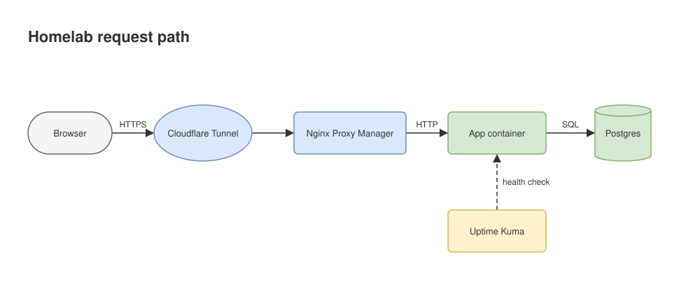

# Schematic

**Made by [Seaynic Labs](https://seayniclabs.com).** Need tools like this built around your own systems? [We do that](https://seayniclabs.com/#business).

Schematic is a set of skills that let an AI assistant draw diagrams as files you can open, edit and commit: draw.io files, network maps, codebase maps, and animated or dark architecture diagrams. Skills only: no server, no account, no background process.

Audience: developers and small teams who want diagrams that live in their repo, not as throwaway images.

## What you get

| Skill | What it makes | Example request |
|---|---|---|
| `getting-started` | Orientation: what each skill does, how to install, which to use | "What can Schematic do?" |
| `diagram` | An editable `.drawio` file, or a `.drawio.svg` that renders on GitHub | "Diagram our checkout flow with the payment provider as an external service." |
| `network-diagram` | A topology diagram and device table from a list you give it | "Map my home network: router, two switches, NAS, three access points." |
| `visualize` | `component-map.html`: an interactive map of a codebase, with real gaps | "Map the project in ~/src/shop and list endpoints nothing calls." |
| `dashmotion` | An animated HTML diagram where requests travel as moving dots | "Animate the request path from CDN to database for my landing page." |
| `architecture-diagram` | A dark, polished architecture diagram as one HTML file | "Draw the AWS setup for this service as a dark architecture diagram." |

`diagram` also checks its own output. `scripts/check_drawio.py` reports broken connections, overlapping shapes and malformed XML.

## Install

**As a Claude Code plugin** (one install, skills load in every project):

```
/plugin marketplace add seayniclabs/plugins
/plugin install schematic@seayniclabs
```

**In any app that reads Agent Skills:** copy the `skills/` folder from this repository into the app's skills folder. Keep each skill folder whole, including its `LICENSE` and `scripts/`. The `getting-started` skill explains the rest.

## Try these

1. "Draw the request path from the browser through a load balancer and two API servers to Postgres, as a `.drawio.svg` for the README."
2. "Map my home network from this list, grouped by subnet. Use example addresses, I'm putting it in a public repo."
3. "Map the project in this folder and tell me which API routes have no caller."
4. "Animate our deploy pipeline (build, test, stage, approve, release) for the landing page."
5. "Explain the password reset flow as a sequence diagram I can edit in draw.io."

The `diagram` skill wrote this one. GitHub shows it as an image, and draw.io opens the same file for editing ([open in draw.io](https://app.diagrams.net/#Uhttps%3A%2F%2Fraw.githubusercontent.com%2Fseayniclabs%2Fschematic%2Fmain%2Fexamples%2Fhomelab-request-path.drawio.svg)).



## Security

Schematic is skills only. It has:

- **No network calls.** The skills do not contact any service. The generated `dashmotion` and `architecture-diagram` pages load fonts and scripts from public CDNs when a browser opens them.
- **No background process.** Nothing runs unless you ask your assistant for a diagram.
- **Writes only the files you ask for.** Each skill names the file it writes and says where it puts it.
- **Reads only what you point it at.** `visualize` reads the project folder you name and skips `.env` files and secret stores.

Report a vulnerability privately through GitHub. See [SECURITY.md](SECURITY.md).

## Credits

Schematic is MIT licensed. Two skills are written by others and used under their licenses; each keeps its `LICENSE` file. Full details in [CREDITS.md](CREDITS.md).

| Skill | Author | License | Source |
|---|---|---|---|
| `dashmotion` | Mars (csthink) | MIT | [csthink/dashmotion @ ae2fe4f](https://github.com/csthink/dashmotion/tree/ae2fe4f28c60caa53da8b15fa3537f4ea576f4ad/skills/dashmotion) |
| `architecture-diagram` | Cocoon AI | MIT | [Cocoon-AI/architecture-diagram-generator @ 4b9087d](https://github.com/Cocoon-AI/architecture-diagram-generator/tree/4b9087d55268c79a935105439dbcd37b630fc3f3/architecture-diagram) |

## Develop

```bash
python3 -m venv .venv && .venv/bin/pip install pytest
.venv/bin/pytest -q tests
python3 scripts/check_skills.py
```

## Changes

See [CHANGELOG.md](CHANGELOG.md). Version 0.1.0 is the first release.

## License

MIT. Copyright (c) 2026 Seaynic Labs.

---

**Built by [Seaynic Labs](https://seayniclabs.com).** We build tools like this around a business's own systems: local-first, with a person approving every change. [See custom integrations](https://seayniclabs.com/#business).
